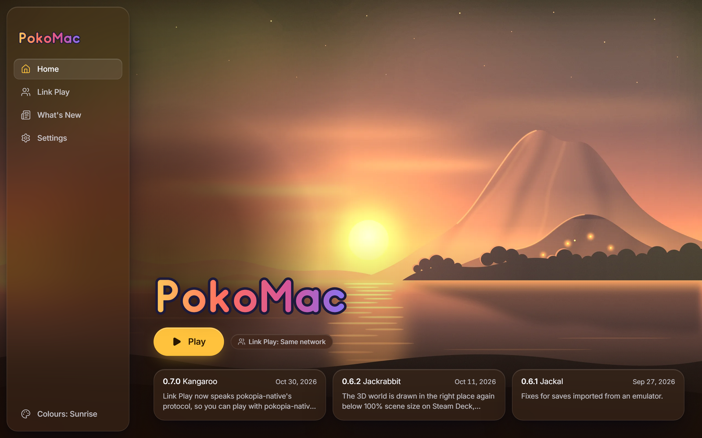
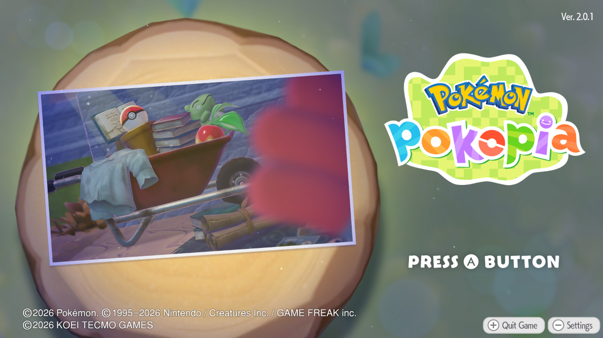
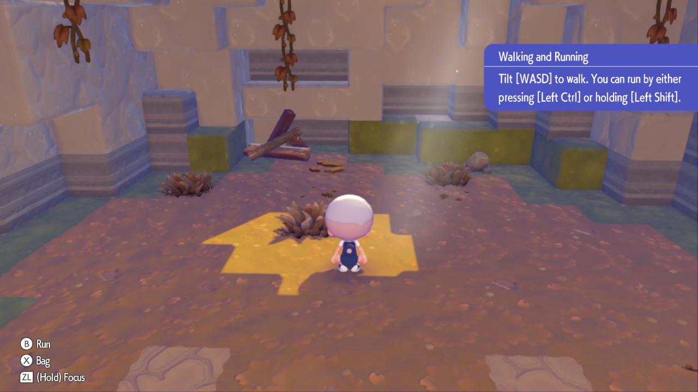
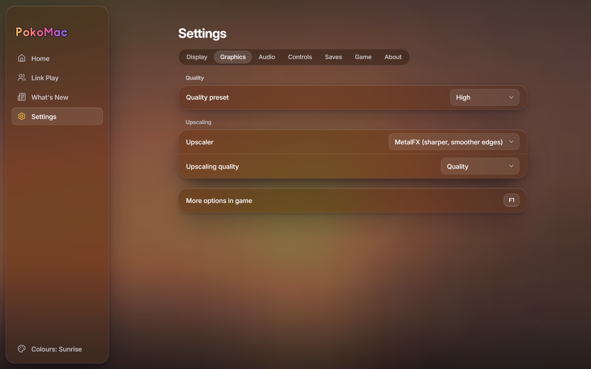

<h1 align="center">PokoMac</h1>

<p align="center">
  <b>Pokémon Pokopia (Switch 2) recompiled to run natively on Apple silicon Macs.</b><br>
  Native arm64, Vulkan over Metal: no emulator, no Wine, no Rosetta.
</p>

<p align="center">
  <a href="https://github.com/Chaos192/PokoMac/releases/latest"><b>Download</b></a> ·
  <a href="#install-and-play">Install</a> ·
  <a href="#common-problems">Help</a> ·
  <a href="docs/MACOS.md">How it works</a> ·
  <a href="https://github.com/Chaos192/PokoMac/issues">Issues</a>
</p>

> [!IMPORTANT]
> **No game files are included.** You need your own dump of Pokémon Pokopia, version **2.0.1a** (the update installed). This project
> provides no game files, keys or dumping tools. Not affiliated with Nintendo, The Pokémon Company or Koei Tecmo; Pokémon is a trademark of
> Nintendo, Creatures Inc. and GAME FREAK inc. (see [LEGAL.md](LEGAL.md)).

## Screenshots

<table>
  <tr>
    <td width="50%"><br><sub>The launcher</sub></td>
    <td width="50%"><br><sub>Title screen</sub></td>
  </tr>
  <tr>
    <td width="50%"><br><sub>Playing, with MetalFX</sub></td>
    <td width="50%"><br><sub>MetalFX in Settings</sub></td>
  </tr>
</table>

## What you need

- A Mac with **Apple silicon** (M1 or newer). Intel Macs are not supported.
- **macOS 14.4** or newer.
- About **20 GB** free: the build files, the game program and the shader cache.
- 16 GB of memory is comfortable.

Nothing else. The first Set up downloads the build tools (Python and Zig, about 100 MB). No Xcode needed.

## Install and play

1. Download `PokoMac-<version>-macos-arm64.zip` from the [latest release](https://github.com/Chaos192/PokoMac/releases/latest), unzip it and
   move **PokoMac.app** to your Applications folder.
2. The app is not notarized. The first time, **right-click it and choose Open**, then **Open** again (or System Settings, Privacy &
   Security, **Open Anyway**).
3. Pick your dump folder and press **Set up**. It checks your files, recompiles the game for your Mac (about 4 to 10 minutes), then
   translates the game's shaders (about 10 minutes on an M-series Max, longer on smaller chips). You can pause and continue later.
4. Press **Play**.

**F1** opens the settings in the game. The middle mouse button toggles the Joy-Con 2 mouse mode (point and click to place and break blocks).

Your dump folder:

```text
Pokopia dump/
├── aoc/                      <- add-on content (DLC), if you have it: installed automatically
│   └── 0400A3A01EE4D001/
│       └── romfs/
├── base/
│   └── exefs/
└── updates/
    └── 655360/
        ├── exefs/
        └── romfs/
```

A single `.nup` file works too.

## Features

- **Native on Apple silicon.** The game's code is recompiled for your Mac's processor on your Mac; graphics run on Vulkan over Metal
  (KosmicKrisp by default, MoltenVK as an option: `[gfx] vulkan_driver = moltenvk` in `pkp.ini`).
- **Any resolution**, Retina included, with **HDR** on XDR and HDR displays (EDR).
- **Controllers:** PlayStation (DualSense, DualShock 4), Xbox, Switch Pro and more, with rumble and motion; on-screen button icons match
  the pad you hold. **Keyboard and mouse** too, with the mouse working in menus. Change any button on the F1 **Controls** page.
- **MetalFX upscaling**, on by default: Apple's temporal upscaler renders the 3D scene smaller and rebuilds it sharper, with smooth edges
  and a higher frame rate. Off, MetalFX anti-aliasing only, FSR 1 and Nearest are in Settings, Graphics.
- **No pop-in:** Set up translates the shaders and prepares the game's pipelines before you play, and new shaders are translated while you
  play.
- **Link Play:** visit friends' islands on the same network or over the internet, with Mac, Windows, Linux and pokopia-native players. The
  launcher opens the router port for you (UPnP or NAT-PMP).
- **Add-on content** from your own dump, **save import** from Ryujinx or Eden, automatic save backups, and **iCloud Drive** save sync
  between your Macs (Settings, Saves).
- **Settings in the game** (F1): graphics, controls and sound, most changes at once.
- **Your folders:** the install folder, mods and the game's photos (Settings, Game), and saves and backups (Settings, Saves) can each go
  where you choose.
- **Report a problem** in one click: the logs go into a zip on your Desktop and a GitHub issue opens.
- **Updates** from this repository's releases, from the launcher.

## Where your saves, logs and settings are

| What | Where |
|---|---|
| The game folder | `~/Library/Application Support/PokoMac` (Settings can choose another one) |
| Saves | `save` in the game folder |
| Settings | `pkp.ini` and `controls.ini` in the game folder |
| Log | `pkp.log` in the game folder (a crash also writes `pkp_crash.txt`) |
| Translated shaders | `shader_cache` in the game folder |
| Launcher settings | `~/Library/Application Support/io.github.chaos192.pokomac/launcher.json` |

Never attach game files, the `build` or `shader_cache` folders, or saves to an issue. `pkp.log` is enough.

## Common problems

- **"PokoMac can't be opened" / "is damaged".** The app is not notarized: right-click, **Open**. If macOS still refuses, run
  `xattr -dr com.apple.quarantine /Applications/PokoMac.app` in Terminal.
- **The launcher says the game files are from an older version, or that the update is missing.** This needs version 2.0.1a. Dump the game
  again with the update installed; the base game alone is not enough.
- **The controller does nothing.** Connect it before you press Play, then check the F1 **Controls** page (the Gamepad line). Bluetooth
  pads must be paired in System Settings first.
- **Something appears a moment late the first time.** Set up prepares what the opening needs, and the rest is translated while you
  play. A shader the game has never shown before can still take a moment the first time; after that it is ready.
- **Link Play: nobody finds you.** Allow PokoMac on the local network when macOS asks (System Settings, Privacy & Security, Local
  Network), and check the macOS firewall.

If it is none of these, use **Settings, About, Report a problem** (or [open an issue](https://github.com/Chaos192/PokoMac/issues) with
`pkp.log`, your Mac model and your macOS version).

## Building from source

See [docs/MACOS.md](docs/MACOS.md#building-from-source-on-a-mac).

## Credits

Based on **[Recompia](https://github.com/Dittobyte/Recompia) by Dittobyte**. The licences of the third-party code PokoMac contains
ship with every release (`licenses/`) and are listed in [CREDITS.md](CREDITS.md).

## License

GPL-3.0, like the project it is based on. Third-party code keeps its own licence.
